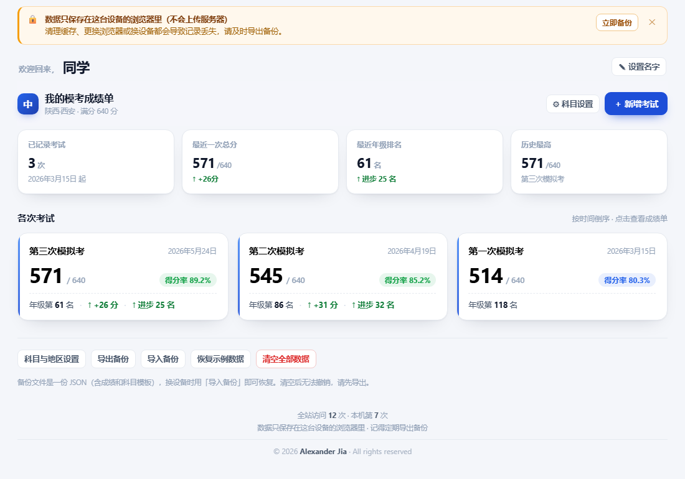

# 中考模考成绩单

一个记录中考（初中升学考试）各次模拟考成绩的**纯静态单页网站**。双击一个 HTML 文件就能用，不需要服务器、不需要安装、不依赖任何第三方库。

**在线使用：<https://zhongkao-mokao.app.workbuddy.host/>**

**在线使用：<https://lantianjialiang.github.io/zhongkao-mokao/>**




---

## 功能

### 1. 考试列表（首页）
- 每次模考一张卡片，按日期倒序排列；
- 卡片显示总分 / 满分、得分率、年级排名，以及相比上一次的分数变化和排名变化（↑ 进步 / ↓ 退步）；
- 顶部概览：已记录次数、最近一次总分、最近年级排名、历史最高分。

### 2. 单次成绩单（详情页）
- 四块关键指标：总分、总分年级排名、总分得分率、丢分缺口（满分 − 得分）；
- **总分目标线**：一条进度条 + 保底/冲刺两条刻度线，直接看出这次离目标差多少分；
- 分科明细表：得分、得分率（带彩色进度条）、班级排名、年级排名、丢分、距保底目标、与上次对比的 ±分；
- 得分率偏低的科目自动标记「待补」，并给出薄弱科目提示；
- 各科丢分条形图，一眼看出丢分最多的是哪一科。

### 3. 趋势分析
- 总分走势、年级排名走势（曲线向上 = 进步）；
- 各科得分率折线：科目可任意勾选，支持「全选 / 全不选」；只选一科时进入单科聚焦（加粗曲线 + 渐变面积 + 数值标注）；图上叠加保底 / 冲刺目标虚线；
- 考试次数多时 X 轴标签自动抽稀，每个数据点带悬停提示，不会看不清是哪一次；
- 各科丢分率对比表：每科一行横向列出历次考试的丢分率，颜色越红丢分越多，一眼看出趋势。

### 4. 科目模板自定义（适配不同省市）
- 「⚙ 科目设置」里可以自由**增删科目、修改满分**，不再局限于固定的七八科；
- 可修改地区名称（如「陕西·西安 / 北京 / 山东」），页面标题随之变化；
- 删除科目有保护：历史成绩不会被删除，进入「已删除的科目」可随时恢复；
- 保底 / 冲刺目标得分率可调（默认 87.5% / 96%）；
- 一键恢复「陕西·西安」默认模板（语文 120、数学 120、英语 120、道法 80、历史 60、物理 80、体育 60 ＝ 640 分）。

### 5. 数据管理
- 所有数据保存在**浏览器 localStorage**，不上传任何服务器；
- 导出 / 导入 JSON 备份（含成绩 + 科目模板），换设备或换浏览器时用导入恢复；
- 页面顶部有醒目提醒，随时可一键导出备份；
- 页脚显示访问统计（全站累计 + 本机打开次数）。

---

## 快速开始

### 方式一：直接打开（最简单）
下载 `index.html`，双击用浏览器打开即可。数据存在本机浏览器里。

### 方式二：本地起个服务（推荐，避免 file:// 限制）
```bash
# Python 3
python -m http.server 8000

# 或 Node.js
npx serve .
```
然后访问 <http://localhost:8000>。

---

## 部署到 GitHub Pages

这个项目是纯静态的，不需要构建，可以直接托管。

先把代码推上 GitHub（首次）：

```bash
git init
git add .
git commit -m "feat: 中考模考成绩记录网站"
git branch -M main
git remote add origin https://github.com/<你的用户名>/<仓库名>.git
git push -u origin main
```

然后开启 Pages：

1. 打开仓库 **Settings → Pages**；
2. **Source** 选 `Deploy from a branch`，Branch 选 `main`、目录选 `/ (root)`，保存；
3. 一两分钟后访问 `https://<你的用户名>.github.io/<仓库名>/`。

> 仓库根目录就是站点入口，`index.html` 会被识别为首页，无需额外配置。
> `site/` 目录是另一个发布平台的副本，用 GitHub Pages 时可以忽略（也可以删掉）。

---

## 目录结构

```
.
├── index.html            # 主站（单文件，含全部 HTML / CSS / JS）
├── site/index.html       # 另一发布平台的副本，内容与主站一致
├── docs/preview.png      # README 预览图
├── README.md
└── .gitignore
```

---

## 计分规则

| 指标 | 算法 |
| --- | --- |
| 单科得分率 | 得分 ÷ 该科满分，保留 1 位小数 |
| 单科丢分 | 满分 − 得分 |
| 总分 | 当前模板下所有科目得分之和 |
| 总分得分率 | 总分 ÷ 模板合计满分 |
| 距保底目标 | 得分 − 满分 × 保底得分率（正数绿色，负数红色） |
| 排名变化 | 本次排名 − 上次排名（负数 = 名次前进 = 进步） |
| 弱科标记 | 得分率 < 75% 标「待补」，< 60% 标「薄弱」 |

---

## 数据结构

localStorage 中会用到这些键：

| 键 | 说明 |
| --- | --- |
| `zhongkao_scores_v1` | 全部考试记录 `{ exams: [...] }` |
| `zhongkao_config_v1` | 科目模板：地区、科目列表、已删除科目、目标得分率 |
| `zhongkao_user_name` | 页面上显示的称呼 |
| `zhongkao_local_visits` | 本机打开次数 |
| `zhongkao_backup_tip_closed` | 备份提醒是否已关闭 |

导出的备份文件是一个 JSON：

```jsonc
{
  "app": "zhongkao-scores",
  "version": 2,
  "exportedAt": "2026-05-24T10:00:00.000Z",
  "config": { "region": "陕西·西安", "subjects": [], "archived": [], "goalFloor": 0.875, "goalTop": 0.96 },
  "exams": [
    {
      "id": "demo3",
      "name": "第三次模拟考",
      "date": "2026-05-24",
      "totalRank": 61,
      "subjects": {
        "chinese": { "score": 112, "classRank": 6, "gradeRank": 58 }
      }
    }
  ]
}
```

> 提示：改科目模板时，成绩记录里的字段会保留。删掉某科只是不再参与统计，重新加回同名列（或从「已删除」恢复）后历史成绩会自动接回。

---

## 技术说明

- **纯静态**：一个 `index.html`，原生 HTML + CSS + JavaScript，零依赖、零构建；
- **图表**：手写 SVG 折线图，无第三方图表库；
- **数据**：全部存在 localStorage，无后端、无账号、无追踪；
- **访问统计**：调用公共计数接口 [abacus.jasoncameron.dev](https://abacus.jasoncameron.dev)（无需注册）。同一标签页会话只计一次；接口不可用时自动降级为只显示本机次数，不影响其他功能；
- **响应式**：手机、平板、桌面均可使用。

---

## 已知限制

- 数据只存在当前设备的当前浏览器里，**清理浏览器数据 / 换设备会丢失**，请定期导出备份；
- 全站访问量依赖第三方免费接口，可能因为网络或服务限制而显示“暂不可用”；
- 是单用户工具，没有账号体系和多设备同步（需要通过备份文件手动迁移）。

---

## 许可

© 2026 **Alexander Jia(My Son)** · All rights reserved

本仓库未附带开源许可证，默认保留所有权利。如需他人自由使用、修改或分发，可自行添加 [MIT License](https://choosealicense.com/licenses/mit/)。
